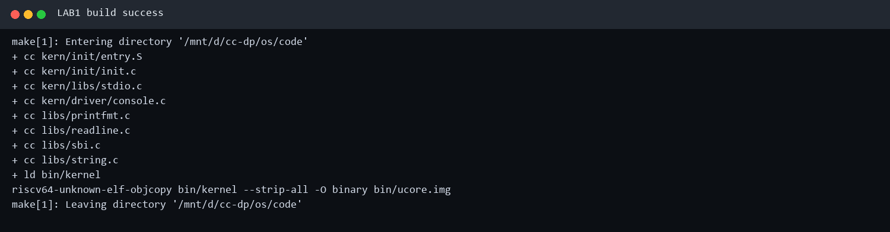
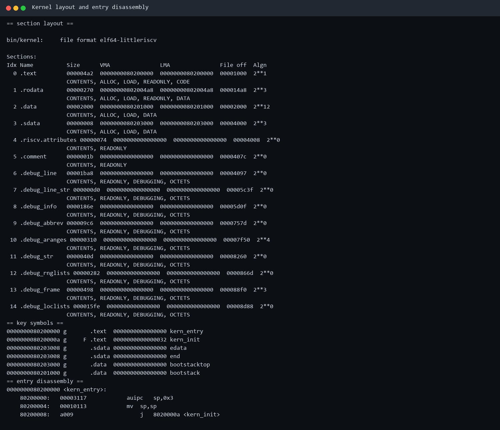
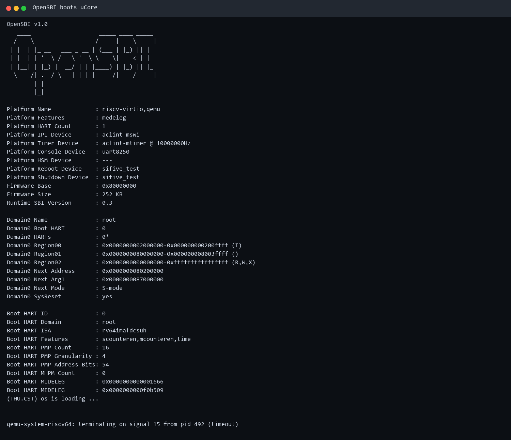
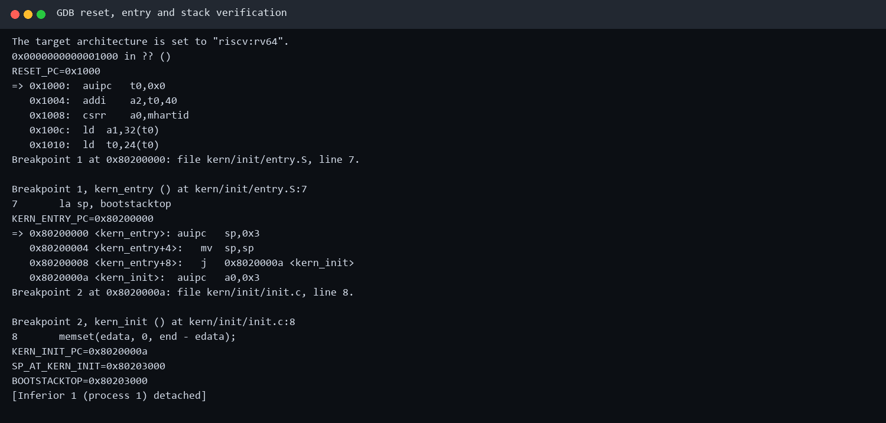
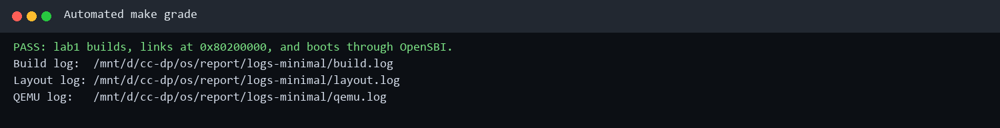

# 操作系统实验报告

## 实验基本信息

| 项目 | 内容 |
|------|------|
| **实验名称** | Lab 1：最小可执行内核与 OpenSBI 启动分析 |
| **小组成员** | 2412930-林永圣、2414063-尹天宇、2412763-王泽鼎 |
| **完成日期** | 2026-10-10 |

### 小组分工

练习如何分工？

| 成员 | 负责的练习/模块 |
|------|----------------|
| 2412930-林永圣 | 构建环境检查；分析 Makefile 与 `ucore.img` 生成流程；维护自动构建测试 |
| 2414063-尹天宇 | 分析 `kernel.ld`、内存布局、内核栈及 `entry.S` 入口代码 |
| 2412763-王泽鼎 | 分析 QEMU/OpenSBI 启动过程；完成 GDB 调试验证、截图和交付检查 |

实验报告如何分工？

三名成员分别撰写自己负责模块的原理、实现与测试说明；王泽鼎负责按照统一模板汇总报告和测试截图，林永圣复核构建命令与参数，尹天宇复核地址、符号和汇编分析，最后由三人共同检查结论与仓库结构。

---

## 一、实验目的

本实验的主要目的是：

1. 熟悉 RISC-V64 裸机内核的交叉编译、链接、镜像生成和模拟运行流程。
2. 理解链接脚本如何控制内核入口、装载地址以及 `.text`、`.rodata`、`.data`、`.bss` 等段的布局。
3. 理解 QEMU、OpenSBI 和 uCore 内核之间的启动与特权级交接关系。
4. 掌握 `kern_entry` 建立内核栈并转入 C 函数 `kern_init` 的过程。
5. 使用 GDB 验证复位向量、内核入口、栈指针与关键符号地址。
6. 学习使用 AI 辅助完成需求核验、兼容性排错、测试设计和实验报告整理。

---

## 二、实验环境

### 2.1 软件与工具链

| 组件 | 版本/配置 |
|------|-----------|
| 宿主环境 | Windows + WSL2 Ubuntu 22.04 |
| 交叉编译器 | `riscv64-unknown-elf-gcc 15.1.0` |
| 模拟器 | `qemu-system-riscv64 7.0.0` |
| 构建工具 | GNU Make 4.3 |
| 调试器 | `riscv64-unknown-elf-gdb 16.3.90` |
| 版本管理 | Git 2.34.1 |
| 实验代码 | 课程提供的 `lab1.zip` |

### 2.2 使用的 AI 工具

| 成员 | AI 编程工具 | 底层模型 | 备注 |
|------|------------|---------|------|
| 2412930-林永圣 | Codex 桌面端 | OpenAI GPT-5（Codex） | 小组共享会话；用于 Makefile 分析和自动测试设计 |
| 2414063-尹天宇 | Codex 桌面端 | OpenAI GPT-5（Codex） | 小组共享会话；用于链接脚本和入口汇编分析 |
| 2412763-王泽鼎 | Codex 桌面端 | OpenAI GPT-5（Codex） | 小组共享会话；用于 OpenSBI/GDB 验证和报告整理 |

**说明：** 三名成员共同审核 AI 生成内容；最终结论均以课程压缩包中的实际代码、交叉编译结果和 QEMU/GDB 实测数据为准。

---

## 三、实验整体逻辑分析

### 3.1 本章节的逻辑主线

本实验围绕“一个最小 RISC-V64 内核如何从源代码变为可启动镜像并获得 CPU 控制权”展开。整个过程形成如下主线：

```text
C/汇编源文件
    ↓ riscv64-unknown-elf-gcc
ELF 目标文件（obj/*.o）
    ↓ riscv64-unknown-elf-ld + kernel.ld
带符号的内核 ELF（bin/kernel）
    ↓ riscv64-unknown-elf-objcopy
裸二进制镜像（bin/ucore.img）
    ↓ QEMU -kernel
OpenSBI 在 M 态初始化平台
    ↓ 切换至 S 态并跳转 0x80200000
kern_entry 建立内核栈
    ↓ tail kern_init
清零 BSS，通过 SBI 输出启动信息
```

这一过程把编译链接、内存布局、RISC-V 特权级、固件接口和 C 运行环境串联起来，是后续中断、内存管理、进程和文件系统实验的共同启动基础。

### 3.2 功能的逐步实现

1. **检查交叉编译环境**：先确认 GCC、binutils、Make、QEMU 和 GDB 均可用，因为后续所有验证都依赖工具链。
2. **编译源文件**：将汇编和 C 文件编译成 RISC-V64 ELF 目标文件，使不同模块可以独立构建。
3. **按链接脚本组织内核**：规定入口为 `kern_entry`、基地址为 `0x80200000`，并按只读代码、只读数据、可写数据、零初始化数据的顺序布局。
4. **生成裸镜像**：保留 `bin/kernel` 供调试，再通过 `objcopy` 生成 QEMU 可加载的 `bin/ucore.img`。
5. **由 OpenSBI 启动内核**：QEMU 准备虚拟硬件和镜像，OpenSBI 在 M 态初始化平台，随后切换到 S 态并跳转内核入口。
6. **建立 C 运行环境**：`kern_entry` 设置栈指针，`kern_init` 清零 BSS 并通过 SBI 控制台输出信息。
7. **用 GDB 验证推理**：观察 `0x1000` 复位代码、`0x80200000` 内核入口以及进入 `kern_init` 时的栈指针，形成闭环验证。

---

## 四、实验内容与实现

### 功能模块：Makefile 构建与镜像生成

**负责人：** 2412930-林永圣

#### 模块功能描述

**涉及的构建目标：**

```make
bin/kernel
bin/ucore.img
qemu
debug
gdb
grade
clean
```

**功能说明：** Makefile 负责发现源文件、交叉编译、链接 ELF、生成裸镜像，并提供运行、调试和自动测试入口。

#### `ucore.img` 的生成过程

1. `tools/function.mk` 中的宏遍历 `libs`、`kern/init`、`kern/libs`、`kern/driver` 等目录，将 `.c` 和 `.S` 源文件映射到 `obj/` 下的目标文件。
2. 每个源文件使用类似命令编译：

   ```bash
   riscv64-unknown-elf-gcc -mcmodel=medany -std=gnu99 \
     -fno-builtin -Wall -O2 -nostdinc -fno-stack-protector \
     -ffunction-sections -fdata-sections -g -Ilibs ... \
     -c kern/init/init.c -o obj/kern/init/init.o
   ```

   - `-mcmodel=medany`：生成适合内核高地址装载的 PC 相对寻址代码。
   - `-std=gnu99`：使用 GNU C99。
   - `-fno-builtin`：不把常用函数替换为宿主标准库内建实现。
   - `-nostdinc`：不搜索宿主系统标准头文件，避免引入不适用于裸机的定义。
   - `-fno-stack-protector`：关闭依赖运行时支持的栈保护代码。
   - `-ffunction-sections -fdata-sections`：每个函数、数据放入独立节，便于链接器删除未使用内容。
   - `-g`：保留调试信息供 GDB 使用。
   - `-c`：只编译，不进行链接。
3. 目标文件通过以下命令链接：

   ```bash
   riscv64-unknown-elf-ld -m elf64lriscv -nostdlib --gc-sections \
     -T tools/kernel.ld -o bin/kernel <目标文件列表>
   ```

   - `-m elf64lriscv`：输出 64 位小端 RISC-V ELF。
   - `-nostdlib`：不链接宿主标准库和启动文件。
   - `--gc-sections`：删除未被引用的节。
   - `-T tools/kernel.ld`：使用课程提供的内核链接脚本。
4. `objdump -S` 生成带源码的反汇编文件，`objdump -t` 生成符号表，便于静态分析和调试。
5. 最后执行：

   ```bash
   riscv64-unknown-elf-objcopy bin/kernel --strip-all -O binary bin/ucore.img
   ```

   `--strip-all` 去除符号和调试信息，`-O binary` 把 ELF 转换为只包含可装载内容的裸二进制镜像。最终同时保留 `bin/kernel`（调试）和 `bin/ucore.img`（启动）。

#### 最终提示词

````markdown
[TASK]
基于课程提供的 lab1.zip，逐条分析 Makefile 中从源文件到
bin/kernel、bin/ucore.img 的构建依赖和实际命令。

[RELY]
- 只使用压缩包内的 Makefile、tools/function.mk 与实测 make V= 输出。
- 目标架构为 riscv64，链接脚本为 tools/kernel.ld。

[GUARANTEE]
- 不修改内核业务逻辑。
- 对每个关键编译、链接、objcopy 参数给出含义和结果。
- 用实际产物和 objdump 结果验证结论。

[SPECIFICATION]
Pre-Condition：WSL 中已安装 RISC-V 交叉工具链。
Post-Condition：能够解释 ucore.img 的完整生成链，并提供可重复构建命令。
````

#### 实现迭代过程

##### 第一次迭代

**最终结果：**

- ✅ 压缩包原始代码能够交叉编译并生成两个目标文件。
- ✅ `bin/kernel` 为 ELF64 little-RISC-V，`bin/ucore.img` 为裸二进制。
- ⚠️ 原有 `grade` 目标引用了压缩包中不存在的 `tools/grade.sh`。

##### 第二次迭代

**问题解决策略：** 增加 `tools/test_lab1.sh`，让 `make grade` 自动完成清理、编译、段布局检查、QEMU 短时运行和关键输出断言。

**最终结果：**

- ✅ `make grade` 输出 PASS。
- ✅ 自动检查入口地址、关键符号、OpenSBI 下一跳和内核启动信息。

---

### 功能模块：链接脚本、内存布局与内核入口

**负责人：** 2414063-尹天宇

#### 模块功能描述

**涉及的符号/函数：**

```asm
kern_entry
bootstack
bootstacktop
```

```c
int kern_init(void) __attribute__((noreturn));
```

#### `kernel.ld` 逐项分析

| 链接脚本内容 | 含义 |
|-------------|------|
| `OUTPUT_ARCH(riscv)` | 指定输出文件的体系结构为 RISC-V。 |
| `ENTRY(kern_entry)` | 将 ELF 入口符号设为 `kern_entry`。 |
| `BASE_ADDRESS = 0x80200000;` | 定义内核预期装载基地址。 |
| `. = BASE_ADDRESS;` | 把链接位置计数器设置到内核基地址。 |
| `.text : { ... }` | 合并入口、普通代码、stub 和链接一次性代码节；入口节优先排列。 |
| `PROVIDE(etext = .);` | 导出代码段结束符号 `etext`。 |
| `.rodata : { ... }` | 放置字符串常量等只读数据。 |
| `. = ALIGN(0x1000);` | 将后续可写数据按 4 KiB 页边界对齐。 |
| `.data : { ... }` | 放置已初始化的全局/静态可写数据。 |
| `.sdata : { ... }` | 放置适合全局指针快速访问的小数据。 |
| `PROVIDE(edata = .);` | 导出已初始化数据的结束位置。 |
| `.bss : { ... }` | 放置零初始化和未初始化的全局/静态数据。 |
| `PROVIDE(end = .);` | 导出内核静态映像结束位置。 |
| `/DISCARD/ : { *(.eh_frame .note.GNU-stack) }` | 丢弃裸机内核不需要的异常展开和宿主栈说明节。 |

实测 `.text` 的 VMA/LMA 均从 `0x80200000` 开始，`kern_entry=0x80200000`，`kern_init=0x8020000a`，`bootstack=0x80201000`，`bootstacktop=0x80203000`。

#### `entry.S` 两条核心指令

```asm
kern_entry:
    la sp, bootstacktop
    tail kern_init
```

- `la sp, bootstacktop` 是伪指令，将链接器确定的内核栈顶地址写入 `sp`。C 函数需要合法栈来保存调用现场和局部变量，因此它建立了从固件环境进入 C 运行环境的基本条件。
- `tail kern_init` 是尾调用伪指令，本实验反汇编为直接跳转到 `kern_init`。由于 `kern_init` 声明为 `noreturn` 并永久循环，不需要保存返回地址。
- `.align PGSHIFT` 把 `bootstack` 按页对齐，`.space KSTACKSIZE` 预留内核栈空间，`bootstacktop` 位于其高地址端。RISC-V 栈向低地址增长，因此把 `sp` 初始化到栈顶是正确的。

#### `kern_init` 的作用

1. 使用链接器提供的 `edata` 和 `end` 清零 BSS，满足 C 语言“未显式初始化的静态存储期对象初值为 0”的语义。
2. 调用 `cprintf`，经 `cons_putc` 和 `sbi_console_putchar` 最终执行 `ecall`，请求 OpenSBI 输出字符。
3. 进入无限循环，保证 `noreturn` 约定成立。

#### 关于规范主引导扇区

传统 BIOS/x86 环境中，规范主引导扇区大小为 512 字节，末尾两个字节为 `0x55`、`0xAA`，BIOS 会把它装入约定地址并执行。当前 RISC-V 实验不采用 BIOS/MBR 启动链，也不生成硬盘主引导扇区；它生成裸内核镜像，由 QEMU/OpenSBI 启动。因此该知识点用于比较两种启动模型，不能直接套用到本实验命令。

#### 最终提示词

````markdown
[TASK]
结合 tools/kernel.ld、kern/init/entry.S、kern/init/init.c 和最终 ELF，
解释内核地址布局以及从汇编入口进入 C 代码的过程。

[RELY]
- BASE_ADDRESS=0x80200000。
- bootstack 由 .align PGSHIFT 与 .space KSTACKSIZE 定义。
- kern_init 被声明为 noreturn。

[GUARANTEE]
- 对 kernel.ld 的每项指令给出含义。
- 通过 objdump 符号表和反汇编验证所有关键地址。
- 区分传统 MBR 引导与本实验 OpenSBI 启动方式。

[SPECIFICATION]
Post-Condition：说明 la sp 与 tail 的操作、目的和必要性，并证明进入
kern_init 时 sp 等于 bootstacktop。
````

#### 实现迭代过程

##### 第一次迭代

**最终结果：** 静态分析得到入口、栈和各段布局，并成功编译 ELF。

##### 第二次迭代

**关键改进点：** 不只依赖源码推测，而是加入 `objdump -h/-t/-d` 和 GDB 检查。实测进入 `kern_init` 时：

```text
SP_AT_KERN_INIT=0x80203000
BOOTSTACKTOP=0x80203000
```

- ✅ 链接地址与实测一致。
- ✅ 内核栈初始化正确。
- ✅ 尾调用到达预期 C 入口。

---

### 功能模块：QEMU、OpenSBI 启动与 GDB 验证

**负责人：** 2412763-王泽鼎

#### 模块功能描述

**涉及的函数：**

```c
uint64_t sbi_call(uint64_t sbi_type,
                  uint64_t arg0,
                  uint64_t arg1,
                  uint64_t arg2);
void sbi_console_putchar(unsigned char ch);
```

#### 启动过程

1. QEMU `virt` 机器复位后，PC 位于 `0x1000` 的 MROM 复位代码。最初几条指令读取 `mhartid` 和 MROM 中的启动参数，然后跳转固件入口。
2. OpenSBI 位于 `0x80000000`，在 M 态初始化 HART、时钟、控制台、PMP 和 trap 委托等平台功能。
3. 本实验使用 `-kernel bin/ucore.img`。镜像实际由 QEMU 装入 `0x80200000`，并将该地址作为 OpenSBI 的下一阶段入口；不是由实验中的 OpenSBI 代码逐扇区读取硬盘。
4. OpenSBI 将下一特权级设置为 S-mode，准备参数和 CSR 后执行 `mret`，控制权转移到 `kern_entry`。
5. 内核设置栈、进入 `kern_init`，清零 BSS，并通过 SBI legacy console 调用输出 `(THU.CST) os is loading ...`。

#### 兼容性问题与修复

压缩包原 Makefile 使用：

```make
-device loader,file=$(UCOREIMG),addr=0x80200000
```

在当前 QEMU/OpenSBI 组合中，虽然镜像被写入内存，但 OpenSBI 显示 `Domain0 Next Address = 0x0`，不会进入内核。改为：

```make
-kernel $(UCOREIMG)
```

之后 `Next Address` 正确变为 `0x80200000`，并出现内核输出。`qemu` 和 `debug` 两个目标均应用了该修复；`gdb` 目标还会在专用 RISC-V GDB 不存在时回退到 `gdb-multiarch`。

#### GDB 观察结果

```text
RESET_PC=0x1000
KERN_ENTRY_PC=0x80200000
KERN_INIT_PC=0x8020000a
SP_AT_KERN_INIT=0x80203000
BOOTSTACKTOP=0x80203000
```

这些数据同时验证了复位链、OpenSBI 交接、链接入口、汇编到 C 的跳转和内核栈设置。

#### 最终提示词

````markdown
[TASK]
在 QEMU virt + OpenSBI 环境中运行课程 lab1，并用 GDB 验证从复位向量
到 kern_entry、kern_init 的控制流和栈指针。

[RELY]
- 使用课程压缩包及其生成的 bin/kernel、bin/ucore.img。
- QEMU 版本为 7.0.0，OpenSBI 运行时版本为 0.3。

[GUARANTEE]
- 先记录原始启动结果，再针对实际证据修改 Makefile。
- 不修改 entry.S 和 init.c 的实验语义。
- 验证 PC=0x1000、kern_entry=0x80200000、sp=bootstacktop。

[SPECIFICATION]
Case 1：若 OpenSBI Next Address 为 0，定位镜像装载与固件跳转参数问题。
Case 2：若 GDB 不可用，检测专用 GDB 与 gdb-multiarch。
Post-Condition：make qemu 输出内核消息，make grade 自动通过。
````

#### 实现迭代过程

##### 第一次迭代

**遇到的问题：**

- 压缩包原始代码编译成功，但 QEMU 仅输出 OpenSBI。
- `Domain0 Next Address` 为 `0x0`，证明固件没有获得内核入口。

**问题解决策略：** 根据 QEMU 启动参数和 OpenSBI 输出，把 `-device loader` 改为 `-kernel`，并同步修改调试目标。

##### 第二次迭代

**最终结果：**

- ✅ OpenSBI 下一跳为 `0x80200000`。
- ✅ 内核输出启动信息。
- ✅ GDB 从 `0x1000` 跟踪到 `kern_entry` 和 `kern_init`。
- ✅ `sp` 与 `bootstacktop` 完全相等。

---

## 五、测试与验证

### 5.1 编译测试

执行 `make` 后，全部 C/汇编文件成功编译，生成 `bin/kernel` 和 `bin/ucore.img`。



### 5.2 ELF 布局与入口反汇编

`objdump` 显示 `.text` 从 `0x80200000` 开始，关键符号和 `kern_entry` 反汇编与源码、链接脚本一致。



### 5.3 QEMU/OpenSBI 启动测试

OpenSBI 显示 `Domain0 Next Address = 0x80200000`，随后内核打印 `(THU.CST) os is loading ...`。截图末尾的 timeout 是自动测试在收集到预期输出后主动结束无限循环内核，并非内核故障。



### 5.4 GDB 调试验证

GDB 验证了复位地址、内核入口、C 入口和栈顶地址。



### 5.5 自动评分测试

执行：

```bash
make grade
```

测试脚本重新构建项目，检查链接地址和关键符号，短时运行 QEMU，并验证 OpenSBI 下一跳和内核输出。



最终结果：

```text
PASS: lab1 builds, links at 0x80200000, and boots through OpenSBI.
```

---

## 六、实验总结与收获

### 6.1 对操作系统的理解

| 实验知识点 | 对应的 OS 原理 | 关系与差异 |
|------------|----------------|------------|
| 交叉编译与裸机链接 | 程序编译、链接和装入 | 普通程序由 OS 装载器装入；内核必须自行规定入口和物理地址，不能依赖现有 OS 运行时。 |
| `kernel.ld` 段布局 | 地址空间与存储保护基础 | 本实验尚未启用页表，但已经建立代码、只读数据、可写数据和 BSS 的边界。 |
| OpenSBI 启动 | Bootstrap/固件启动过程 | OpenSBI 类似固件运行时，负责 M 态平台初始化并把控制权交给 S 态内核。 |
| M/S 特权级 | 内核态与用户态 | RISC-V 在传统内核态/用户态之外增加 M 态，固件与 OS 通过 SBI 分层。 |
| SBI `ecall` | 分层接口与系统调用思想 | 系统调用是用户程序请求 OS；SBI 是 S 态 OS 请求 M 态固件，层次不同但接口思想相似。 |
| 内核栈初始化 | 函数调用与运行时上下文 | 进入 C 代码前必须建立可靠栈；后续 trap、进程切换也需要更复杂的上下文管理。 |
| BSS 清零 | 程序装入语义 | 普通应用由加载器保证 BSS 为零；裸机内核需要在初始化阶段自行完成。 |

OS 原理中很重要、但本实验尚未涉及的内容包括：中断与异常处理、物理/虚拟内存管理、页表、进程与线程、调度、同步互斥、系统调用、设备驱动和文件系统。这些功能都建立在本实验验证过的启动、链接和基本运行环境之上。

### 6.2 AI 协作开发的经验

1. **先核验资料版本。** 公开指导书、参考文本和课程压缩包可能采用不同实验编号；最终必须以教师提供代码和当前交付要求为准。
2. **让结论落到工程证据。** 对入口地址、栈顶和启动链的解释不能只依赖文字，应使用 `objdump`、OpenSBI 输出和 GDB 数据交叉验证。
3. **提示词中提供边界。** 明确 `[RELY]`、`[GUARANTEE]` 和 `[SPECIFICATION]`，可以避免 AI 引入与当前实验版本不一致的模块。
4. **保留失败过程。** “能编译但不能启动”不是无效结果；`Next Address = 0x0` 正是定位 QEMU 参数问题的关键证据。
5. **自动化可重复验证。** 将手工检查转化为 `make grade`，减少环境变化或后续修改造成的回归。

---

## 参考资料

1. 课程提供的 `lab1.zip` 与实验报告模板。
2. [uCore OS(on RISC-V64) 最小可执行内核指导](https://nankai.gitbook.io/ucore-os-on-risc-v64/lab0.5)
3. [RISC-V Privileged Architecture Specification](https://github.com/riscv/riscv-isa-manual)
4. [OpenSBI 官方仓库](https://github.com/riscv-software-src/opensbi)
