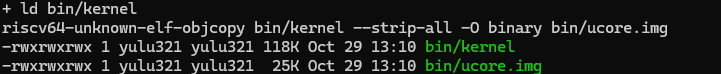
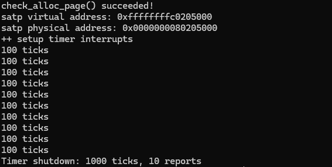
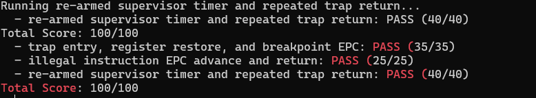
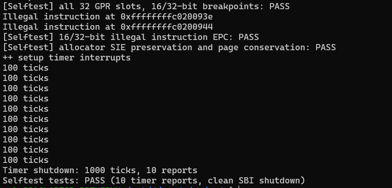
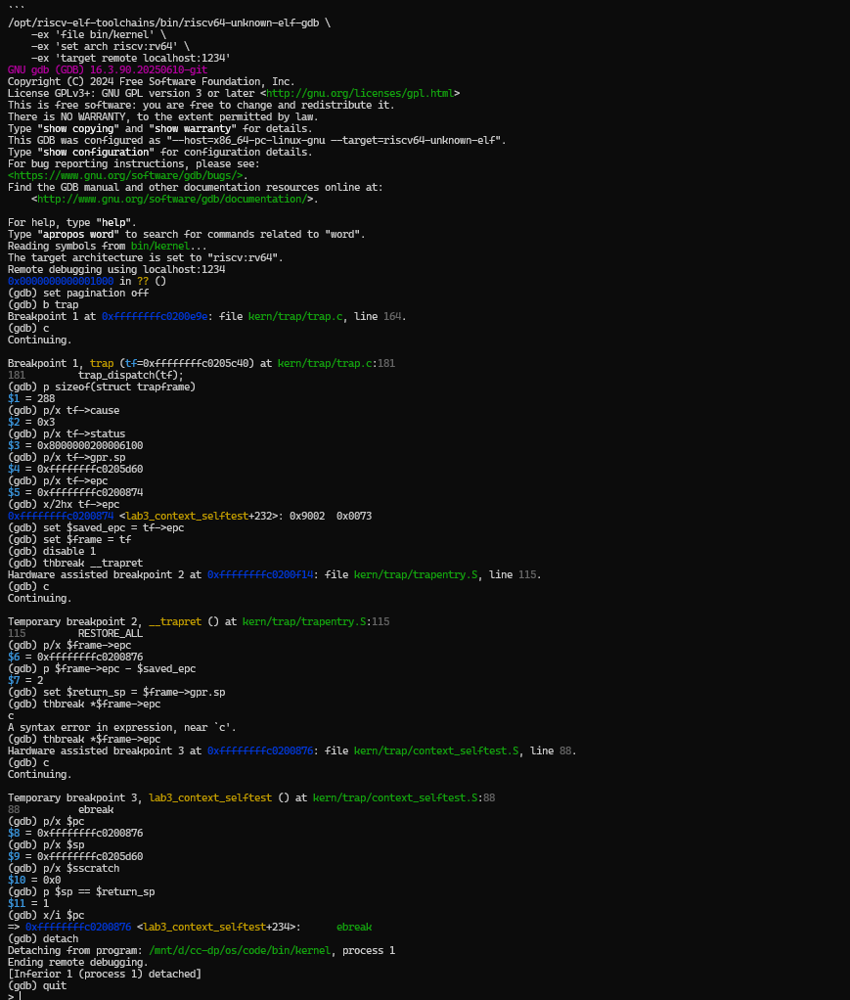

# 操作系统实验报告

## 实验基本信息

| 项目 | 内容 |
|------|------|
| **实验名称** | Lab 3：中断、异常与 Trap 上下文恢复 |
| **小组成员** | 2412930-林永圣、2414063-尹天宇、2412763-王泽鼎 |
| **实验日期** | 2026-10-28 |

### 小组分工

| 成员 | 负责的练习/模块 |
|------|----------------|
| 2412930-林永圣 | Lab2 内存管理代码迁移；Trap frame 布局、`RESTORE_ALL` 和汇编入口 |
| 2414063-尹天宇 | 中断和异常分类；时钟续设、统计关机、异常 EPC 更新 |
| 2412763-王泽鼎 | 独立自检、GDB 验证、报告与截图整理 |

---

## 一、实验目的

1. 理解 RISC-V 中断、异常以及 M/S/U 特权级之间的关系。
2. 理解 `stvec`、`scause`、`sepc`、`sstatus`、`stval`、`sscratch` 的用途。
3. 按已有 `SAVE_ALL` 与 `struct trapframe` 布局恢复上下文，建立汇编与 C 函数的调用闭环。
4. 正确处理断点、非法指令和持续时钟中断，避免错误的返回位置或只触发一次的时钟。
5. 观察局部关闭中断对物理内存管理临界区的保护。

## 二、实验环境与要求来源

| 组件 | 环境/用途 |
|------|-----------|
| 宿主环境 | Windows + WSL2 Ubuntu 22.04 |
| 目标架构 | RV64，支持压缩指令扩展 C |
| 交叉工具链 | `riscv64-unknown-elf-gcc/ld/objcopy` |
| 模拟器 | `qemu-system-riscv64 7.0.0`，`virt`，单 hart，默认 128 MiB |
| 固件 | OpenSBI v1.0 |
| 调试器 | `riscv64-unknown-elf-gdb` |
| 构建与自动验证 | GNU Make、Python 3、课程随包评分脚本 |
| 实验代码 | 本次提供的 `lab3.zip`，内部目录为 `lab3_new/` |
| AI 协作工具 | Codex 桌面端；代码结论依据编译、QEMU 与 GDB 的实际结果 |

## 三、实验整体逻辑

### 3.1 章节主线与执行流程

本章先介绍中断与异常的分类和特权级变化，再定义 Trap frame 与汇编入口，接着把保存的状态交给 C 函数分类处理，最后用周期性时钟验证多次进入、处理和返回，并讨论关闭中断保护临界区。主线是“能进入 Trap”到“能处理并正确恢复执行”。

```text
kern_entry → 建立 Sv39 映射和内核栈 → kern_init
  → 清零 BSS、解析 DTB、初始化控制台与物理内存管理
  → idt_init：sscratch=0，stvec=__alltraps（Direct 模式）
  → clock_init：使能 sie.STIE，设置首个 deadline，ticks=0
  → intr_enable：设置 sstatus.SIE
  → CPU 收到 Trap：写入 sepc/scause/stval/sstatus，跳到 stvec
  → SAVE_ALL：在当前内核栈上形成 Trap frame
  → a0=sp，jal trap → trap_dispatch
  → interrupt_handler / exception_handler
  → __trapret → RESTORE_ALL → sret
  → 恢复原执行流；达到 1000 ticks 后通过 SBI 关机
```

`idt_init` 这个名称沿用课程框架，实际设置的是 RISC-V `stvec`，并没有 x86 的 IDT 表。`sret` 根据保存的 SPP 返回 S 或 U 态，本实验基础路径从 S 态进入并返回 S 态，并非每次 Trap 都会发生用户态切换。

### 3.2 硬件与软件各自负责什么

| 状态 | 作用与保存责任 |
|------|----------------|
| `stvec` | 软件设置统一入口；Direct 模式下低两位为 0 |
| `scause` | 硬件记录原因；最高位为 1 表示中断，低位表示原因编号 |
| `sepc` | 硬件记录被中断位置或异常指令地址；软件可修改返回位置 |
| `sstatus.SPP` | 记录 Trap 前处于 S 态还是 U 态 |
| `sstatus.SPIE/SIE` | Trap 进入时保存并关闭 S 态中断；`sret` 恢复中断使能 |
| `stval` | 异常辅助信息；框架字段名仍为 `badvaddr` |
| `sscratch` | 软件约定的暂存 CSR；本实验用于暂存进入 Trap 前的 sp |
| 通用寄存器、栈 | 不会由硬件自动压栈，必须由汇编保存与恢复 |

OpenSBI 运行在 M 态，内核运行在 S 态。固件负责底层定时器与 SBI 服务；本实验通过 `sbi_set_timer` 设置时钟事件，接收的是 S 态时钟中断。

## 四、Lab2 依赖代码迁移

**负责人：2412930-林永圣**

课程包在 `pmm.c` 标出 Lab2 依赖。本次复用上次 `page_init` 与 Best-Fit 实现，并选择 `best_fit_pmm_manager`，使物理页管理先通过自检，再开始时钟与 Trap 测试。

与直接覆盖整个旧 `pmm.c` 不同，本次保留 Lab3 框架给 `alloc_pages/free_pages/nr_free_pages` 增加的 `local_intr_save/local_intr_restore`。它们保存调用前的 SIE，临界区中关闭本 hart 的中断，结束时仅在原先开启的情况下恢复。这避免从原本关中断的上下文返回时错误地打开中断。

`page_init` 从 DTB 取 RAM 范围，在内核末尾建立页描述符数组，保留固件、内核和元数据，只登记剩余整页。该实现仍以本次单段 QEMU DRAM 为目标，不声称支持通用多段物理内存布局。本实验使用 Best-Fit 管理可用物理页。

启动沿用已验证的两项环境适配：QEMU 使用 `-kernel bin/ucore.img`；根页表在高地址映射之外保留物理 `0x80000000` 区域的临时恒等映射，保证开启分页后、跳入高地址前的指令能够继续取指。

## 五、功能模块一：Trap 上下文恢复与入口

**负责人：2412930-林永圣**

### 5.1 Trap frame 布局

`struct trapframe` 由 32 个通用寄存器槽和 4 个 CSR 状态槽组成，RV64 下共 **36×8=288 字节**，仍满足 16 字节栈对齐。

| 字节偏移 | 内容 |
|----------|------|
| 0～248 | `x0`～`x31`，每项 8 字节 |
| 16 | `x2/sp`，保存进入 Trap 前的原始栈指针 |
| 256 | `status`，对应 `sstatus` |
| 264 | `epc`，对应 `sepc` |
| 272 | `badvaddr`，对应 `stval` |
| 280 | `cause`，对应 `scause` |

### 5.2 `RESTORE_ALL`

先用临时的 `s0/s1` 读出并写回 `sstatus/sepc`，再从各槽位恢复全部可写通用寄存器。`s0/s1` 自身的原值随后也必须恢复，不能因为用来搬运 CSR 就遗漏。

`sp` 必须最后恢复，因为此前所有 LOAD 都以当前 `sp` 为 Trap frame 基址。槽位 2 中已经保存原栈指针，因此直接从该槽加载；不能先移动 `sp` 再读剩余寄存器。`x0` 恒为零，不需要恢复；`scause/stval` 是诊断状态，不需要为了 `sret` 重新写回。

### 5.3 `__alltraps` 与 `__trapret`

`SAVE_ALL` 结束后，当前 `sp` 指向完整 Trap frame。按照 RISC-V ABI，令 `a0=sp` 再 `jal trap`，将参数交给 `void trap(struct trapframe *tf)`。C 函数遵守调用约定恢复自身栈，返回后落到 `__trapret`，恢复状态并执行 `sret`。

必做实现保留两处 `#lab3 function1 2412930` 标记，没有改变 `SAVE_ALL` 布局、`struct trapframe` 或 `trap()` 签名。新工具链不识别旧名 `sbadaddr`，因此在汇编头部增加 `#define sbadaddr stval`，保持原保存宏的指令与语义。

## 六、功能模块二：中断与异常处理

**负责人：2414063-尹天宇**

### 6.1 Trap 分发与中断分类

`trap_dispatch` 将 `tf->cause` 按有符号数解释，负数表示最高位为 1，即中断。`interrupt_handler` 清除最高位后按原因编号分派，识别用户、Supervisor、Machine 的软件、时钟和外部中断。

本实验只有 S 态时钟分支执行完整设备处理，其他已识别分支按课程要求打印类型；未知分支打印 `Unknown interrupt: cause ...` 和完整 Trap frame。列出 Machine 类型只是分类能力，不代表 M 态中断实际交给本 S 态处理器。

### 6.2 持续时钟、计数与关机

每次 `IRQ_S_TIMER` 先调用 `clock_set_next_event()`，再将 `ticks` 增加一次。SBI 定时器设置的是一次性 deadline，若不重新设置，内核不会持续获得期望的周期事件。

当前 `timebase=100000`，QEMU 的 `time` 频率为 10 MHz，名义间隔为 10 ms。`ticks` 为 `volatile`，使等待循环能够读取中断更新后的值。每到 100 的整数倍输出 `100 ticks`；第 10 次统计输出后显示 `Timer shutdown: 1000 ticks, 10 reports` 并调用 SBI 关机。输出中的 100 是本轮统计间隔，不是累计值。

由于下次事件按“当前 time + 间隔”设置，处理开销会使总墙钟时间略长于理论 10 秒；本实验不实现绝对周期补偿，也不把 ticks 当作精确墙钟。

### 6.3 非法指令和断点异常

`exception_handler` 对 `CAUSE_ILLEGAL_INSTRUCTION` 输出 `Illegal instruction at ...`，对 `CAUSE_BREAKPOINT` 输出 `Breakpoint at ...`，然后根据指令首半字的低两位确定跳过 2 或 4 字节。低两位不是 `11` 时为 16 位指令；本次目标的普通 32 位指令则跳过 4 字节。

因此 `c.ebreak` 返回时 `epc+=2`，明确的非压缩 `ebreak` 返回时 `epc+=4`；非法指令也不能一律固定加 4。时钟中断保持 EPC 不变，因为它需要恢复被打断的执行，而不是跳过一条尚未执行的正常指令。

其他异常按要求打印 Trap frame，没有实现通用异常恢复。若原故障仍存在，返回原 EPC 可能再次触发异常；不能把“输出诊断”描述成“修复缺页”。当前指令长度判断适用于可读取的 S 态 RV64 16/32 位指令，不包含更长编码和不可信用户地址的通用取指逻辑。

必做处理函数位于 `//lab3 function2 2414063` 标记后，原有分发、打印、`trap_in_kernel` 等函数保持课程语义。

## 七、测试与运行证据

### 7.1 课程评分

保留随包 `test_lab3.c/.h`、`test_lab3_context.S` 的原始测试内容；`inject.py` 只对临时评分副本注入测试。`grade.sh` 的运行参数从 loader 改成与本机固件兼容的 `-kernel`，没有改评分条件、分数和期望输出。注入脚本只清理了行尾空白。

| 项目 | 分值 | 实测结果 |
|------|------|----------|
| Trap 入口、寄存器恢复和断点 EPC | 35 | PASS |
| 非法指令返回与处理器兜底分支 | 25 | PASS |
| 重新设置时钟与多次返回，达到 ticks=200 | 40 | PASS |
| 合计 | 100 | `Total Score: 100/100` |

课程评分结果摘要见 [grade-results.log](evidence/grade-results.log)，保留实际运行中的测试名称、评分及总分。课程测试不单独证明自动关机，因此补充下列独立测试。

### 7.2 独立自检与关机

`context_selftest.S` 先保存调用者的 callee-saved 寄存器，再对通用寄存器设置测试值，对 gp/tp 保留原值；在连续的 `c.ebreak` 和 32 位 `ebreak` 前后分别保存 32 个寄存器槽并逐项比较。x0 固定为 0，sp 比较原栈，ra 与 a0 也包含在内。测试结束恢复调用者的原有寄存器，避免测试函数自身违反 ABI。

非法指令自检连续执行 16 位保留编码与 32 位自定义非法编码，紧随其后的指令计算结果必须等于 42，以检验返回位置。内存包装自检分别在 SIE=0 和 SIE=1 下申请/释放页，检查原中断状态及空闲页计数。

自动运行器等待 QEMU 实际退出，要求无 panic/FAIL、退出码为 0、恰好 10 行 `100 ticks`，并检查 1000 ticks 的关机信息；超时视为失败，不能只出现某个成功字符串就判定整个测试成功。

| 命令 | 验证范围 | 日志 |
|------|----------|------|
| `make selftest` | 两种断点长度、两种非法指令长度、全部 GPR 槽、中断状态保存、定时关机 | [selftest-run.log](evidence/selftest-run.log) |
| `make shutdown-test` | 不启用扩展宏的默认内核，1000 ticks 后正常退出 | [shutdown-run.log](evidence/shutdown-run.log) |

### 7.3 GDB 验证

本次先用 `make gdb-evidence` 生成 [gdb.log](evidence/gdb.log)，再由小组使用 `make debug` 与 `make gdb` 手动复核。报告采用手动 GDB 操作截图，分别在 C 入口、`__trapret` 和 `sret` 后的返回地址停下；截图与日志中的关键数值一致：

- Trap frame 大小为 288，cause=`0x3`，status 的 SPP 位为 1，来自 S 态。
- 原异常地址 `0xffffffffc0200874`，首半字为 `0x9002`，即压缩断点。
- C 处理后 EPC 为 `0xffffffffc0200876`，增量为 2。
- `sret` 后 PC 等于修改后的 EPC，sp 恢复为 `0xffffffffc0205d60`，`sscratch=0`。手动执行 `p $sp == $return_sp` 得到 1，自动日志中的对应检查为 `SP restored = 1`。

这些数值来自本次带 `LAB3_SELFTEST` 的构建；启用其他宏或修改代码会改变符号地址，应以对应 ELF 为准。此处验证的是客体内核的 Trap 流程，没有将其表述为宿主 GDB 调试 QEMU 源码。

### 7.4 实际运行截图与结果分析

以下五组图片由小组按 [启动与截图步骤.md](启动与截图步骤.md) 实际运行后提供。构建图保留链接、镜像生成和产物列表区域，GDB 采用带完整命令的手动操作截图。

**图 1：默认构建与产物检查。** 2026-10-29 在 WSL 中执行 `make clean`、`make` 和 `ls -lh bin/kernel bin/ucore.img`，终端显示链接生成 `bin/kernel`，随后通过 `riscv64-unknown-elf-objcopy` 生成裸镜像 `bin/ucore.img`。产物列表分别显示约 118 KiB 的 ELF 文件和约 25 KiB 的镜像，说明干净构建完成，调试文件与启动镜像均已生成。内核运行行为再由后续时钟、评分、自检和调试结果验证。



**图 2：持续时钟与自动关机。** `check_alloc_page() succeeded!` 说明物理页分配器先通过自检。默认内核根页表的虚拟地址为 `0xffffffffc0205000`，对应物理地址 `0x80205000`。初始化时钟后连续输出十行 `100 ticks`，最终显示 `Timer shutdown: 1000 ticks, 10 reports`，与每 100 次中断统计一次、累计十次后关机的设计一致。正常退出状态另由默认关机自动测试日志核对。



**图 3：课程评分。** 截图集中展示三项评分，分别为上下文恢复与断点 35/35、非法指令返回 25/25、持续时钟 40/40，合计 `Total Score: 100/100`。这些结果覆盖课程规定的基础验收；独立自检与自动关机结果进一步验证相关边界。



**图 4：独立自检。** 三项自检均显示 PASS：32 个 GPR 槽与 16/32 位断点、16/32 位非法指令 EPC、中断状态保存与页数守恒。截图中的 `Illegal instruction at ...` 来自主动作出的受控异常测试，随后仍能继续输出 PASS，说明处理器正确跳过对应指令。末尾的 `Selftest tests: PASS (10 timer reports, clean SBI shutdown)` 表明运行器还检查了十次统计和正常关机。



**图 5：手动 GDB 调试。** 小组在暂停的 QEMU 上连接 GDB，逐条读取 Trap frame 大小、cause、status、原 sp 和 EPC。原 frame 地址为 `0xffffffffc0205c40`，原 sp 为 `0xffffffffc0205d60`，两者相差 `0x120`，即 288 字节。首半字 `0x9002` 对应压缩断点；停到 `__trapret` 后，`p $frame->epc - $saved_epc` 的结果为 2。再停到返回地址时，PC 为 `0xffffffffc0200876`，sp 与保存值相等，`sscratch=0`，说明执行已经经过 `sret` 并恢复原内核栈。

手动操作中曾把继续命令 `c` 与上一条表达式一并输入，GDB 报语法错误；重新单独输入 `thbreak *$frame->epc` 和 `c` 后正常命中返回断点。该提示来自调试命令输入，不是客体内核异常；截图保留这一过程与最终检查结果。



## 八、参考框架比较与知识点总结

### 8.1 与课程框架的比较

课程的 `SAVE_ALL` 与结构体定义是保存关系的基线。实现逐项使用同一偏移恢复状态，没有改变公共数据布局。C 入口遵循已有 ABI；类型分发继续依据 cause 的最高位。实现补充了按指令长度更新 EPC 和缺失的关机次数参数，并通过独立自检验证寄存器恢复和中断状态保存。

指导书部分注释沿用 `iret` 或 IDT 等名称，实际目标是 RISC-V，最终返回指令是 `sret`。理解时以当前指令、CSR 和实际执行结果为准，不直接照搬其他架构术语。

### 8.2 重要知识点及其对应关系

| 实验知识点 | 对应 OS 原理及关系/差异 |
|------------|------------------------|
| 中断与异常分发 | 异步设备事件与同步指令事件；RISC-V 用 Trap 统称两者 |
| Trap frame | 保存执行上下文；本实验是现场恢复，不等于切换了进程 |
| `jal trap` 与 `sret` | 前者是普通函数调用，后者按照特权 CSR 恢复执行级别与中断状态 |
| `sepc` 的调整 | 异常恢复策略依原因而定；不能统一对全部 Trap 加 4 |
| 定时中断 | 是时间片与调度的基础；本实验只计数，没有实现调度器 |
| 保存/恢复 SIE | 保护本 hart 临界区；不能替代多核锁 |
| `sscratch` 暂存原 sp | 使保存后的 frame 能记录进入 Trap 前的栈位置；本实验使用当前内核栈 |
| SBI `ecall` | S 态内核请求 M 态固件服务，用于定时器、控制台和关机 |

### 8.3 `do { ... } while (0)` 的作用

`local_intr_save(x)` 使用该形式将多条宏语句包装成一条语法上的语句，允许调用处自然添加分号，并避免在 `if (...) macro; else ...` 中产生悬空 else 或作用域问题。条件恒为 0，所以执行一次，不是自旋等待。

### 8.4 原理中重要但本实验尚未覆盖的内容

本实验没有完整覆盖进程/线程调度与 PCB、用户程序装载、通用系统调用 ABI、缺页分配与换页、设备外部中断控制器与磁盘网络驱动、多核自旋锁和内存序、嵌套中断的系统性管理、抢占与实时性保证。

## 九、AI 协作、规格与迭代

### 9.1 spec 如何编写

按前置条件、正常行为、边界/失败行为和后置不变量描述模块。依赖迁移的规格要求有效映射及合法内存范围，物理页不进入保留区且保留 SIE 包装；模块一要求 36 个槽的偏移不变、sp 最后恢复、C 参数正确、返回 EPC 取自处理后的 frame；模块二要求重新设置每次时钟、计数恰好增加一次、按照长度跳过受控异常、未知原因输出现场。

测试规格与实现规格分开：独立自检检查全部寄存器槽、两种指令长度和原中断状态；关机测试要求 QEMU 真正退出；GDB 规格要求分别观察 C 处理前后和 `sret` 后的状态，保证检验的是独立可观察结果。

### 9.2 prompt 如何编写

提示词沿用前两次 `PROMPT / RELY / GUARANTEE / SPECIFICATION` 四段结构，共五条，见 [prompt.md](prompt.md)。分别对应 Lab2 依赖迁移、汇编模块、中断异常模块、独立自检，以及 GDB 验证与证据整理。每条注明负责人、修改范围、可信依赖和禁止通过修改课程断言制造通过的要求。

## 十、总结

本实验完成了 Lab2 依赖迁移、Trap 上下文恢复、C 层分发、断点与非法指令返回、持续时钟和统计关机。课程评分达到 100/100；独立测试进一步检查了两种指令长度、寄存器槽一致性、中断状态和页数守恒。手动 GDB 截图与自动日志共同验证了压缩断点 EPC 增加 2 以及 `sret` 后的栈恢复。
