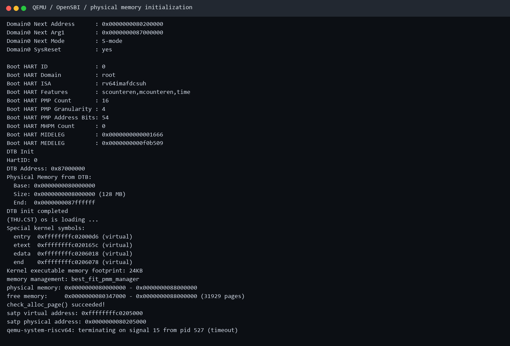
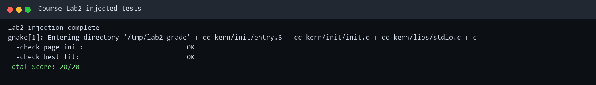
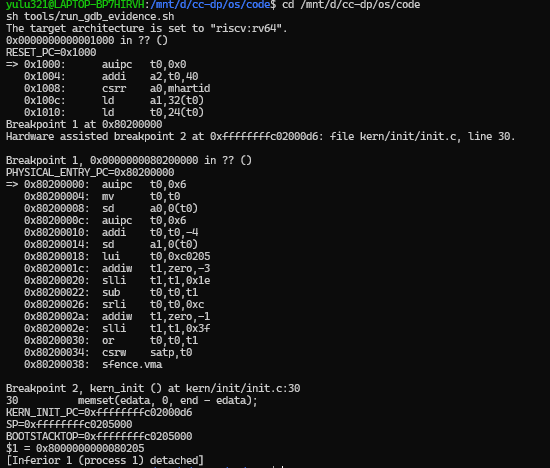
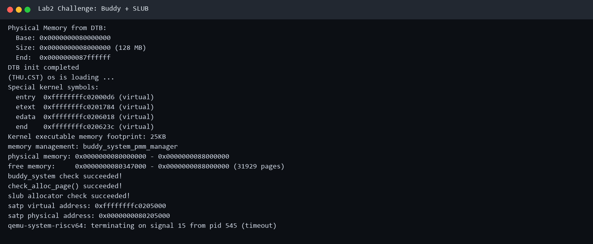

# 操作系统实验报告

## 实验基本信息

| 项目 | 内容 |
|------|------|
| **实验名称** | Lab 2：物理内存管理、Best-Fit 与扩展分配器 |
| **小组成员** | 2412930-林永圣、2414063-尹天宇、2412763-王泽鼎 |
| **完成日期** | 2026-10-18 |

### 小组分工

| 成员 | 负责的练习/模块 |
|------|----------------|
| 2412930-林永圣 | First-Fit 阅读分析、物理内存探测结果接入、`page_init` 与页描述符初始化 |
| 2414063-尹天宇 | Best-Fit 分配器、Buddy System 扩展分配器及对应测试 |
| 2412763-王泽鼎 | 简化 SLUB、Sv39/QEMU/GDB 调试、自动测试、报告与证据整理 |

---

## 一、实验目的

1. 理解物理地址、虚拟地址、页、页帧和页描述符之间的关系。
2. 理解 RISC-V Sv39 地址翻译、`satp` 和 `sfence.vma` 的作用。
3. 根据设备树给出的物理内存范围建立 `struct Page` 描述符数组。
4. 正确排除 OpenSBI、内核镜像和页描述符数组占用的空间，并把剩余整页交给物理内存管理器。
5. 实现 Best-Fit 连续物理页分配算法，并在释放时按地址排序、合并相邻空闲块。
6. 使用 QEMU、课程随包测试和 GDB 验证从物理入口切换到高地址内核以及内存分配器行为。
7. 完成 Buddy System、简化两层 SLUB 和硬件内存探测三个选做 Challenge。

---

## 二、实验环境

| 组件 | 实际环境/用途 |
|------|---------------|
| 宿主环境 | Windows + WSL2 Ubuntu |
| 目标架构 | RISC-V 64 位（RV64） |
| 交叉工具链 | `riscv64-unknown-elf-gcc/ld/objcopy` |
| 模拟器与固件 | `qemu-system-riscv64` + OpenSBI v1.0 |
| 调试器 | `riscv64-unknown-elf-gdb`，目标架构 `riscv:rv64` |
| 构建工具 | GNU Make |
| 实验代码 | 课程提供的 `lab2.zip` |

课程指导书 Lab2：<http://oslab.mobisys.top/lab2026/_book/lab2.html>。本报告依据课程指导书的实验任务与报告要求，并结合本组实际源码和已有运行证据编写。

---

## 三、实验整体逻辑

### 3.1 从启动到物理页分配

```text
QEMU 加载 OpenSBI 与 ucore.img
    ↓
OpenSBI 在 M-mode 初始化平台
    ↓ 跳转到物理地址 0x80200000，进入 S-mode
kern_entry 保存 hartid/DTB 地址
    ↓
设置 Sv39 根页表，刷新 TLB，跳到高虚拟地址
    ↓
kern_init 解析 DTB，得到物理内存范围
    ↓
pmm_init 选择 Best-Fit 管理器（Challenge 构建选择 Buddy）
    ↓
page_init 建立 Page 数组并登记可用空闲页
    ↓
分配器自检；Challenge 构建继续执行 SLUB 自检
```

实验把“地址翻译机制”和“物理页分配策略”分开：启动页表负责让 CPU 能用虚拟地址访问内核；`pmm_manager` 负责管理哪些物理页空闲、如何分配和回收。

从章节组织来看，指导书先介绍虚拟地址、页表和 TLB，说明内核如何访问内存；再介绍启动页表与高地址内核初始化，建立运行前提；随后通过 DTB 探测内存、建立 Page 描述符和空闲区，把硬件内存转换为可管理资源；最后学习 First-Fit、实现 Best-Fit，并扩展到 Buddy 和 SLUB。其逻辑是先解决“地址怎样翻译”，再解决“内存有哪些、哪些可用”，最后解决“按什么策略分配与回收”。

核心初始化调用关系为 `kern_init → dtb_init → pmm_init → init_pmm_manager → page_init → init_memmap`，其中 `init_memmap` 分派到当前管理器的同名接口；完成初始化后执行管理器自检。后续 `alloc_pages/free_pages` 只是统一入口，真正的分配策略由当前 `pmm_manager` 决定。

### 3.2 核心数据结构

`struct Page` 并不是一页内存本身，而是某个物理页帧的管理记录：

```c
struct Page {
    int ref;
    uint64_t flags;
    unsigned int property;
    list_entry_t page_link;
};
```

- `ref`：页引用计数。
- `PG_reserved`：该页被内核等占用，不能分配。
- `PG_property`：该描述符是一个空闲连续块的首元素。
- `property`：在 First-Fit/Best-Fit 的空闲块首元素中表示连续空闲页数；Buddy 的空闲块也用它记录块大小。
- `page_link`：把各空闲块首元素连接成双向链表。

First-Fit/Best-Fit 的 `free_area_t` 同时维护空闲块链表 `free_list` 和空闲页总数 `nr_free`。链表按物理地址递增排列，方便释放时判断前后块是否相邻；Buddy 则改用分阶链表。

---

## 四、练习 1：理解 First-Fit 连续物理内存分配

`kern/mm/default_pmm.c` 是课程提供的 First-Fit 实现，本练习以阅读和分析为主。

- `default_init`：初始化空闲块链表，将空闲页总数清零。
- `default_init_memmap(base, n)`：清除这段可用页的保留标志和引用计数，把整段登记为一个空闲块；块首页的 `property=n`，随后按物理地址插入链表。当前源码的该函数不执行相邻合并，合并逻辑在 `default_free_pages` 中。
- `default_alloc_pages(n)`：从链表头开始寻找第一个能容纳 `n` 页的块。摘除该块；若块更大，则把尾部剩余页登记为新空闲块；最后减少 `nr_free` 并返回起始页。这里的“第一个”就是 First-Fit 的核心。
- `default_free_pages(base, n)`：清理待释放页的状态，把新块按地址插入链表，再分别与前后相邻块合并，最后增加 `nr_free`。

完整分配过程是：`pmm_init → init_memmap → alloc_pages → pmm_manager->alloc_pages`。上层只依赖统一的 `pmm_manager` 接口，因此可以不改变调用者就替换 First-Fit、Best-Fit 或 Buddy 策略。

### 4.1 思考题：First-Fit 是否有改进空间

有。当前实现每次从链表头线性查找，最坏时间复杂度为 O(m)，其中 m 为空闲块数。可以记录上次位置改成 Next-Fit，或按大小建立分离链表/平衡树以缩短查找；还可设置最小剩余块阈值并改进碎片整理。不过索引越复杂，元数据维护和释放合并成本也越高。Buddy 是另一种取舍：查找和合并更规则，但请求会向 2 的幂取整，产生内部碎片。

---

## 五、物理内存初始化（基础支撑）

**负责人：2412930-林永圣**

### 5.1 功能目标

`page_init` 需要把 DTB 报告的物理内存转换成内核可管理的页集合，同时保证固件、内核和管理元数据不会被误分配。

本机 DTB 实测结果为：

- 起始物理地址：`0x80000000`
- 大小：`0x08000000`，即 128 MiB
- 结束边界：`0x88000000`（半开区间，不包含该地址）
- 页大小：4 KiB
- 总页号上界：`PPN(0x88000000)`

### 5.2 实现过程

1. 将 `va_pa_offset` 设置为 `PHYSICAL_MEMORY_OFFSET`，使 `PADDR(kva)` 能把高虚拟地址换算为物理地址。
2. 从 `get_memory_base()` 和 `get_memory_size()` 取得 DTB 的探测结果，计算物理内存半开区间。
3. 设置 `npage = PPN(mem_end)`；`pages[0]` 对应 `nbase = PPN(0x80000000)`，因此转换关系为：

   ```text
   page2ppn(page) = page - pages + nbase
   ```

4. 将 `pages` 放在链接器符号 `end` 之后并按 4 KiB 对齐，为每个 DRAM 页建立一个 `struct Page`。
5. 先把全部描述符标记为保留。这样内核镜像、页描述符数组及其对齐空隙默认不会进入空闲链表。
6. 计算描述符数组结束后的第一个完整物理页，只将 `[free_mem, mem_end)` 交给 `init_memmap`。

### 5.3 前置与后置状态

**前置条件：** `dtb_init` 已成功解析内存节点；链接器提供 `end`；高地址内核映射已经生效。

**成功后的状态：**

- `va_pa_offset` 正确反映虚实地址差值；
- `npage` 与 DTB 内存末端一致；
- `pages` 非空、按页对齐且位于内核末尾之后；
- 内核尾页和描述符数组所在页仍为 reserved；
- 空闲链表非空，且 `page2pa/pa2page` 可以往返转换。

若 DTB 内存范围非法、可用空间不足或地址假设不成立，内核使用断言停止，而不是建立可能破坏内核的错误空闲表。

需要说明实现边界：当前代码固定要求 `mem_begin == DRAM_BASE`，并通过 `mem_end > mem_begin`、`free_mem < mem_end` 等断言检查布局。它适用于本次 QEMU 单段 DRAM 配置，但尚未实现多段 RAM、完整保留区解析、所有中间算术的溢出检查和直接映射上界裁剪。没有可用空间时当前选择断言停止；“不足一整页”的路径也没有独立测试。提示词中的健壮性要求是设计规格，不能据此声称当前代码已经完整覆盖所有异常输入。

---

## 六、练习 2：Best-Fit 连续物理页分配

**负责人：2414063-尹天宇**

### 6.1 算法含义

请求连续 `n` 页时，Best-Fit 遍历全部空闲块，在所有 `property >= n` 的候选块中选择尺寸最小者。若存在恰好为 `n` 页的块，可以立即停止搜索。该策略尽量避免把很大的空闲块用于很小的请求。

例如空闲块大小依次为 8、3、5 页，请求 4 页：First-Fit 会选择 8 页块，Best-Fit 会选择 5 页块，并留下 1 页空闲块。

### 6.2 初始化与注册

- `best_fit_init` 初始化空闲链表并将 `nr_free` 清零。
- `best_fit_init_memmap` 清除可用页的 reserved 标志，把整个初始可用区登记为一个空闲块。
- `init_pmm_manager` 改为选择 `best_fit_pmm_manager`，使上层继续通过统一的 `alloc_pages/free_pages` 机制调用新策略。

### 6.3 分配流程

1. 断言 `n > 0`。
2. 若 `n > nr_free`，立即返回 `NULL`，且不得改变链表和计数。
3. 遍历链表，记录当前满足要求且尺寸最小的块。
4. 从链表摘除选中的原块。
5. 若块大于请求，将剩余部分设置为新的空闲块首元素，并放回原地址顺序位置。
6. 清除已分配块首元素的 `PG_property`，更新 `nr_free`，返回块起始页。

### 6.4 释放与合并

释放连续 `n` 页时，先检查各页既不是 reserved，也不是其他空闲块的首元素；随后清理引用和属性，把 `base` 标记成新的空闲块首元素。

新块按地址插入链表后依次尝试：

- 若前一块末端等于 `base`，合并到前一块；
- 若合并后块的末端等于后一块，再合并后一块。

这样一次释放最多完成左右两次合并，避免产生可合并却分散的外部碎片，并保持 `nr_free` 等于所有空闲块 `property` 之和。

### 6.5 思考题：Best-Fit 是否有改进空间

有。当前实现为找最小候选块需要遍历全部空闲块，最坏为 O(m)。可同时维护按地址和按大小的两个索引，或采用分桶链表/平衡树，使查找更快而地址索引仍负责合并。还可对很小的尾部碎片设置阈值，避免产生难以利用的小块。代价是释放、拆分时必须同步多个索引，实现与并发控制更复杂。

---

## 七、Sv39 启动映射与兼容性修正

**负责人：2412763-王泽鼎**

### 7.1 页表与 `satp`

Sv39 使用三级页表，普通页为 4 KiB。根页表一页包含 512 个 8 字节页表项；顶级叶子项可直接映射 1 GiB 区域。`satp` 的 MODE=8 表示 Sv39，低 44 位保存根页表物理页号。修改 `satp` 后使用 `sfence.vma` 刷新旧的 TLB 翻译结果。

内核链接在高虚拟地址 `0xffffffffc0200000`，物理入口为 `0x80200000`，两者相差 `0xffffffff40000000`。

### 7.2 发现的问题

原压缩包使用 `-device loader,file=...,addr=0x80200000`。本机 QEMU/OpenSBI 输出 `Domain0 Next Address = 0x0`，不会把控制权交给内核。改用 `-kernel bin/ucore.img` 后，下一跳变为 `0x80200000`。

随后发现原启动页表只映射高地址区域。CPU 在物理地址 `0x80200000` 执行 `csrw satp` 和 `sfence.vma` 后，下一条指令仍从低地址 PC 取指；若没有临时恒等映射，低地址会立刻变成未映射地址。

### 7.3 修正方法

根页表同时建立两个指向物理 `0x80000000` 的 1 GiB 叶子项：

- VPN[2] = 2：临时恒等映射 `0x80000000 → 0x80000000`，保证开启分页后的过渡指令可执行；
- VPN[2] = 511：高地址映射 `0xffffffffc0000000 → 0x80000000`，供内核正式运行。

随后汇编代码把 `sp` 和跳转目标设置为高虚拟地址，进入 `kern_init`。GDB 实测 `satp = 0x8000000000080205`：最高位域表示 Sv39，根页表物理页号为 `0x80205`，对应物理地址 `0x80205000`。

---

## 八、扩展练习 Challenge

### 8.1 Buddy System 物理页分配器

新增 `buddy_pmm.c/.h`，用 order 0～15 的多条链表分别保存 `1、2、4……32768` 页的空闲块。初始化时把实际的 31929 个可用页分解成若干“地址对齐且大小为 2 的幂”的块，因此不要求总页数本身为 2 的幂。

分配 `n` 页时先计算能覆盖请求的最小 order；若该级为空，则从更高级取块并不断二分，右半块放回低一级链表。释放时用相对起点页号异或块大小得到伙伴地址；只有伙伴空闲且同阶时才合并并继续向上。`property` 在空闲块首页记录块的实际页数。该方案查找、分裂和合并最多经过固定的 order 数，但非 2 的幂请求会向上取整并产生内部碎片。

自检覆盖 1、3、5 页请求（实际占 1、4、8 页）、计数守恒、释放恢复，以及两个 1 页伙伴合并后再次满足 2 页请求。

核心函数中，`buddy_init` 初始化分阶链表；`buddy_init_memmap` 将初始区间分解入链；`buddy_alloc_pages` 完成阶数计算、查找和分裂；`buddy_free_pages` 完成伙伴计算、合并与计数恢复；`buddy_check` 验证基本行为。块对齐以管理区起点的相对页号为基准。当前实现只接收一个初始区间，页数不超过最大阶对应的 32768 页，并非通用多区间内存管理器。现有自检没有独立证明所有失败路径、非伙伴禁止合并和复杂交错分配均正确，这些属于后续可扩展测试。

### 8.2 简化两层 SLUB 任意大小分配器

新增 `slub.c/.h`，体现题目要求的两层结构：底层通过 `alloc_pages/free_pages` 取得和归还页；上层设置 16～2048 字节八个 size class，每个 slab 占一页，在页头记录所属缓存、对象总数、空闲数和对象空闲链表。请求选择不小于目标大小的最小 class；空闲 slab 用尽时申请新页；一页中全部对象归还后立即释放该页。

大于 2048 字节的对象使用连续多页回退路径，并在页首保存页数。自检覆盖 1、17、100、2000、6000 字节请求、实际内存写入、全部释放后的页数守恒，并分配 70 个 64 字节对象迫使同一 size class 跨越多个 slab。

核心函数中，`slub_init` 初始化各尺寸缓存；新 slab 创建逻辑负责申请页面、布置页头并串联空闲对象；`slub_alloc` 选择尺寸级或大对象路径；`slub_free` 将对象归还空闲链表，并在 slab 全空时归还页面；`slub_check` 执行自检。准确地说，当前测试对五个对象执行了 `memset` 写入，没有逐字节读回比对，因此只验证了分配、可写访问和释放计数，不能声称已经证明数据隔离。尺寸 0、16/17、2048/2049 的完整边界组合及重复释放检测也未全部覆盖。该实现是教学用简化 SLUB，没有 Linux SLUB 的每 CPU 缓存和并发管理机制。

### 8.3 思考题：OS 如何获得硬件可用物理内存

OS 不应靠猜测地址范围，而应由启动固件/引导程序传入硬件描述。RISC-V/ARM 常用设备树 DTB 的 `/memory` 节点提供 RAM 的 base 和 size，同时依据 `reserved-memory`、固件占用区、内核镜像与 MMIO 区域扣除不可用范围；x86 常读取 BIOS E820 或 UEFI Memory Map。对各区间排序、去重、裁剪并按页对齐后，才把真正可用的完整页交给物理页分配器。本实验中 OpenSBI 在寄存器 `a1` 传入 DTB 地址，`dtb_init` 解析后由 `page_init` 完成保留与登记。

### 8.4 Challenge 的选择方式

默认 `make` 仍启用课程要求的 Best-Fit。`make challenge-qemu` 通过编译宏选择 Buddy，并同时启用 SLUB 自检；`make challenge-test` 自动构建、限时运行 QEMU 并检查四个成功标志。两者共享同一套 `pmm_manager` 上层接口。

---

## 九、参考实现比较与知识点总结

### 9.1 与 ucore_lab 参考实现的比较

本次课程包中 `ucore_lab` 的 `default_pmm.c` 是 First-Fit 参考实现，也是 Best-Fit 的接口与链表维护基线。我们的实现与参考答案相同点是：都使用 `Page/free_area_t`、地址有序空闲链表、尾部分割和释放时前后合并，并通过 `pmm_manager` 注册。主要区别是参考 First-Fit 找到首个可用块就返回，而我们的 Best-Fit 扫描全部候选并保存最小者；遇到恰好匹配时才提前结束。我们的实现还明确清除已分配首页的 `PG_property/property`，并保证失败分配不改变链表和计数。

Challenge 没有改动基础接口：Buddy 改为按 order 保存块并用异或定位伙伴；SLUB 位于物理页分配器之上，不把对象分配逻辑混入 `Page` 管理。这使基础实验和扩展功能可以分别测试。

### 9.2 实验知识点与 OS 原理的关系

| 实验知识点 | 对应原理及关系/差异 |
|---|---|
| `struct Page` | 是物理页帧的内核元数据，不是页内容本身；对应物理内存帧管理。 |
| 空闲块链表与合并 | 对应连续分配和外部碎片；地址有序便于发现相邻块。 |
| First-Fit/Best-Fit | 是相同机制上的不同策略；前者偏速度，后者尝试减少单次剩余空间。 |
| Buddy | 以 2 的幂换取快速分裂/合并，减轻外部碎片但带来内部碎片。 |
| SLUB size class | 在“页”之上分配小对象，减少按整页分配的浪费，并利于对象复用和缓存局部性。 |
| Sv39 页表 | 负责虚拟地址翻译和权限；它与“哪些物理页空闲”的分配策略是两个层次。 |
| DTB 内存探测 | 把硬件/固件描述转换成 OS 可管理资源，随后仍需扣除保留区。 |

其中，连续页分配要求一块中的物理页相邻；分页原理允许连续虚拟页映射到不连续物理页，因此“启用了分页”不代表本实验的 `alloc_pages(n)` 可以返回分散页面。外部碎片指空闲区域被切成小块，总量足够却没有足够大的连续块；内部碎片指已经分给调用者的块大于实际需求，Buddy 的向上取整和 SLUB 的尺寸级都可能产生此类浪费。

TLB 是虚拟页到物理页翻译的缓存，命中时减少页表访问；未命中时需要遍历页表，并不必然触发缺页。实验通过 `satp` 和启动映射展示了地址转换的基本机制，但没有实现完整的进程级虚拟内存管理。`sfence.vma` 用于同步地址转换状态，避免继续使用旧映射。

### 9.3 OS 原理中重要但本实验未直接实现的内容

1. **进程、线程和调度：**解决谁占用 CPU、何时切换上下文。本实验只有启动后的内核流程，没有多个进程竞争 CPU。
2. **按需分页与缺页处理：**访问尚未建立映射的页面时，由异常处理程序分配或装入页面。本实验建立启动映射并分配物理页，没有完整缺页服务。
3. **页面置换与交换：**内存不足时选择牺牲页并写入外存，涉及 FIFO、LRU、Clock 等策略。本实验没有交换区和换入换出流程。
4. **进程地址空间与隔离：**为不同进程建立页表、设置用户权限，并在切换时处理地址空间标识。本实验主要使用统一的内核映射。
5. **写时复制与共享内存：**通过只读映射、引用计数和缺页异常实现延迟复制或跨进程共享。本实验虽有 Page 引用计数字段，但没有完整实现这些机制。
6. **同步互斥和多核并发：**多个执行流同时分配内存时需要锁或其他同步手段。本实验分配器没有完整的多核并发保护。
7. **文件系统与设备管理：**负责持久化数据和设备抽象。本实验只借助固件控制台与 DTB，没有完整文件系统或通用驱动框架。

这些知识与本实验的关系是：物理页管理提供底层资源，后续的进程、虚拟内存和文件系统缓存等功能会在此基础上继续构建；实现物理分配器并不等于已经实现完整操作系统。

---

## 十、实验结果与验证

### 10.1 编译

在 `code/` 中执行：

```bash
make clean
make
```

所有 C/汇编文件均通过 `-Werror` 编译，成功生成 `bin/kernel` 与 `bin/ucore.img`。


### 10.2 QEMU 启动和内存初始化

执行 `make qemu` 后，实测关键输出：

```text
Domain0 Next Address      : 0x0000000080200000
Domain0 Next Mode         : S-mode
Physical Memory from DTB:
  Base: 0x0000000080000000
  Size: 0x0000000008000000 (128 MB)
memory management: best_fit_pmm_manager
free memory: 0x0000000080347000 - 0x0000000088000000 (31929 pages)
check_alloc_page() succeeded!
```



末尾的 timeout 终止信息是测试脚本主动结束 QEMU；内核按设计进入永久循环，并非崩溃。

### 10.3 课程随包测试

执行 `make grade`。该目标复制代码到 `/tmp/lab2_grade`，注入压缩包自带的测试文件，再重新编译运行；未修改 `basic_check`、`best_fit_check` 或注入测试内容。

```text
-check page init: OK
-check best fit:  OK
Total Score: 20/20
```



该分数表示本地压缩包附带测试全部通过，不替代教师平台的最终评分。

### 10.4 GDB 调试

执行：

```bash
sh tools/run_gdb_evidence.sh
```

调试结果形成了完整的地址切换证据：

- 复位 PC：`0x1000`；
- OpenSBI 交接后的物理入口：`0x80200000`；
- 开启 Sv39 后的 `kern_init`：`0xffffffffc02000d6`；
- `sp`：`0xffffffffc0205000`；
- `bootstacktop`：`0xffffffffc0205000`；
- `satp`：`0x8000000000080205`。



### 10.5 Challenge 自动测试

执行 `make challenge-test` 后，Buddy 与 SLUB 均完成实际 QEMU 自检：

```text
memory management: buddy_system_pmm_manager
buddy_system check succeeded!
check_alloc_page() succeeded!
slub allocator check succeeded!
-check buddy system: OK
-check slub allocator: OK
Challenge tests: PASS
```



---

## 十一、运行与复现实验步骤

在 WSL 中进入仓库的 `code` 目录：

```bash
cd /mnt/d/cc-dp/os/code
```

### 11.1 编译

```bash
make clean
make
```

### 11.2 启动

```bash
make qemu
```

看到 `check_alloc_page() succeeded!` 即说明内核启动和分配器自检完成。内核不会自行退出；按 `Ctrl+A`，松开后按 `X` 退出 QEMU。

### 11.3 基础实验自动测试

```bash
make grade
```

预期最后出现：

```text
Total Score: 20/20
```

### 11.4 Challenge 自动测试与启动

```bash
make challenge-test
```

预期出现 `Challenge tests: PASS`。若要交互观察 Buddy 和 SLUB 的完整启动输出：

```bash
make challenge-qemu
```

看到两个 `check succeeded` 后，以 `Ctrl+A`、松开再按 `X` 退出 QEMU。由于该目标会用 Challenge 宏重新构建，之后若需恢复默认 Best-Fit，请重新执行 `make clean && make`。

### 11.5 GDB 手动调试

终端 1：

```bash
make debug
```

终端 2：

```bash
make gdb
```

每条 GDB 命令输入后单独回车，例如：

```gdb
set pagination off
p/x $pc
x/5i $pc
b *0x80200000
hbreak kern_init
c
p/x $pc
p/x $sp
p/x &bootstacktop
p/x $satp
```

也可用 `sh tools/run_gdb_evidence.sh` 自动完成同一组检查并生成日志。

---

## 十二、AI 协作、验证与迭代说明

本实验按照课程视频建议，以职责闭合的功能模块为提示词粒度，并使用 `PROMPT / RELY / GUARANTEE / SPECIFICATION` 四段式描述需求。AI 负责代码实现建议、差异检查和故障定位；小组成员通过以下方式复核：

1. 阅读 `Page`、`free_area_t`、地址转换宏和课程测试，确认接口语义。
2. 用断言和课程注入测试检查成功、失败、拆分、最优选择和相邻合并。
3. 观察 OpenSBI 的下一跳、DTB 内存范围与内核实际输出。
4. 用 GDB 直接检查复位 PC、物理入口、高虚拟地址、栈顶和 `satp`。
5. 对“只显示 OpenSBI”和“开启分页后无输出”分别迭代提示词与实现，而不是绕过测试或伪造结果。
6. 分别运行基础评分和 Challenge 自检，确认扩展代码没有改变默认 Best-Fit 验收路径。

本次提交所需的六条功能提示词见 [prompt.md](prompt.md)。报告中的规格说明描述设计目标，测试结果只陈述已有证据支持的范围。

### 12.1 各练习的 spec 如何编写

我们先阅读函数接口、数据结构与课程测试，再按“输入和前置条件—正常行为—失败行为—后置状态与不变量”编写 spec。这样能够明确什么情况算正确，也能防止 AI 只实现正常路径。

**First-Fit 阅读练习：**本练习不要求生成新分配器，因此没有另列实现提示词。分析规格是：输入为正数 n；分配选择链表中第一个足够大的块，必要时拆分；失败返回 NULL；释放按地址插入并合并。通过跟踪四个核心函数，理解它们如何维护链表、`PG_property` 和 `nr_free`。

**page_init：**前置条件是 DTB 提供有效内存范围、启动映射已经生效；正常行为是设置偏移和页号上界、建立 Page 数组、排除已占用区、按页对齐后登记空闲页；失败行为是无效布局明确停止；后置状态是保留页不能分配、空闲页不越界。规格还提出地址溢出、上界和无完整页检查，当前实现的覆盖限制已在第 5 节说明。

**Best-Fit：**前置条件是 n 大于 0、空闲表一致；正常行为是在全部候选中选最小块并拆分；失败时返回 NULL 且状态不变；释放后与前后相邻块合并。关键不变量是空闲块不重叠、地址有序、空闲块页数总和等于 `nr_free`。保留课程测试，避免用修改测试代替修复实现。

**Buddy 实现：**输入为单个合法初始区间；请求向上取整为 2 的幂；高阶块可逐级分裂，同阶空闲伙伴可逐级合并；失败分配不改变状态。块对齐以管理区起点为基准，空闲块总页数与计数一致。

**Buddy 测试：**独立写出测试规格，要求覆盖阶数计算、分裂、伙伴合并、失败分配和最终页数恢复。现有自检已覆盖 1/3/5 页请求及基本释放合并；失败路径、非伙伴对照等尚需补充，不能把测试提示词中的目标全部视为已完成。

**SLUB 实现：**小对象选择最小尺寸级，没有空闲对象时创建 slab；大对象按管理头与载荷总长申请连续页；释放后维护空闲对象链表，整页全空时归还。关键不变量是对象与元数据不重叠、对象地址合法、回收后页数恢复。

**SLUB 测试：**要求覆盖尺寸级边界、同页多对象、跨 slab、多尺寸同时存活、大对象和回收。现有自检覆盖五种尺寸、写入、跨 slab 和页数恢复；逐字节读回、完整边界与复杂交错测试尚未全部实现。

### 12.2 各练习的 prompt 如何编写

六条提示词使用统一的 `PROMPT / RELY / GUARANTEE / SPECIFICATION` 结构：`PROMPT` 指定文件和任务；`RELY` 列出已有接口与可信依赖；`GUARANTEE` 列出需要交付的函数和行为；`SPECIFICATION` 把正常、失败和边界分支写成可检查条件。

- 提示词 1 给出 DTB 接口、`end`、Page 数组和地址换算宏，约束 page_init 的保留区与对齐处理，由林永圣负责。
- 提示词 2 明确 Best-Fit 的“最小可满足块”语义、拆分合并和禁止修改课程测试的限制，由尹天宇负责。
- 提示词 3、4 分别要求 Buddy 模块接入和测试生成。把实现与测试分开，可以独立审查算法是否满足规格，以及测试是否真正覆盖关键分支，由尹天宇负责。
- 提示词 5、6 分别要求 SLUB 两层设计和测试生成，强调页层接口、尺寸边界、对象写入和回收计数，由王泽鼎负责。

运行环境诊断和调试过程在报告中说明，`prompt.md` 保留指导书要求的功能提示词。提示词的质量标准是约束清楚、依赖明确、结果可验，而不是文字越长越好。

### 12.3 AI 协作过程中出现的 bug 与处理

**问题一：编译通过，但停在 OpenSBI，没有内核输出。**最初仅检查镜像生成，未确认固件的下一阶段入口。本机输出 `Domain0 Next Address=0x0`，说明镜像放入内存并不等于 OpenSBI 已获得正确入口。定位时比较 Makefile 参数和固件输出，将装载方式调整为 `-kernel bin/ucore.img`，并统一相关运行入口。复核依据是 Next Address 变为 `0x80200000`、Next Mode 为 S-mode。这个问题来自课程包与本机运行环境的适配，不能简单归因于 AI 生成的页分配算法。

**问题二：固件已经交接，开启分页后仍然没有输出。**将范围缩小到 `entry.S`，结合反汇编与 GDB 检查 `satp` 切换前后的 PC。原页表只有高地址映射，而开启分页后尚未跳转的指令仍在低地址执行。修正是在保留高地址映射的同时加入低地址恒等映射，保证过渡取指，再跳转到高地址 `kern_init`。已有 GDB 截图记录了物理入口、高地址 PC、栈顶及 `satp`，支持该修正。

**问题三：GDB 连接到已经运行结束初始化的内核。**曾经连接后停在 `kern_init` 的 `while(1)`，此时再设置入口断点并继续运行，不会重新经历启动流程。处理方法是退出旧调试会话，启动全新的暂停 QEMU（`-S -s`），再连接并设置断点。之后截图观察到复位 PC 为 `0x1000`，再依次到达物理入口和高地址初始化函数。连接超时则检查 QEMU 是否启动及 1234 端口是否存在；多行命令被当作一条时改为逐条执行。

**问题四：扩展测试返回 Error 1，但编译日志未说明运行失败原因。**实验过程中曾出现 `make challenge-test` 在链接后失败。仅凭这条信息不能断定 Buddy 或 SLUB 的算法错误，应继续检查测试脚本、QEMU 输出及成功标志匹配。后续已有 PASS 截图支持正常运行，但现有材料不足以完整还原该次失败的唯一根因，因此不编造具体修复结论。

这些经历表明，AI 协作时需要把“编译成功、固件交接、分页切换、分配器自检、自动测试通过”分层验证。当前资料没有记录到一个可以独立复现并归因于 AI 的 Best-Fit 算法错误，因此不虚构链表损坏或计数错误作为修复经历。

### 12.4 验证范围与提交前检查

第 10 节的编译、20/20、Challenge PASS 和 GDB 结果来自已有运行证据；本次仅修订报告，没有重新运行这些测试。基础测试成功不能证明任意内存布局、多核并发或全部异常路径都正确。现有 GDB 是客体内核调试，尚无宿主 GDB 附加 QEMU 源码、追踪 MMU/TLB 的完整证据，因此不将其表述为已完成指导书中的 QEMU 源码级调试任务。

必做实现仍保留 `// lab2 function1 2412930` 和 `// lab2 function2-2 2414063` 标记，对应位置已经填写代码；核对这两个实现文件没有残留 `YOUR CODE`。仓库沿用课程统一交付格式，在 `lab2` 分支以 `code/` 保存源码、`report/` 保存报告、提示词及截图。[prompt.md](prompt.md) 和本文相互对应，图片使用相对路径引用。

---

## 十三、总结

本实验完成了 First-Fit 阅读分析、DTB 物理内存接入和 Best-Fit 连续页分配；并完成 Buddy System、简化两层 SLUB、硬件物理内存探测三个 Challenge。默认构建继续使用 Best-Fit，Challenge 构建通过同一接口切换 Buddy 并在其上测试 SLUB。

在工程验证中还解决了本机 QEMU/OpenSBI 镜像交接方式和 Sv39 开启瞬间的低地址取指问题。最终课程随包测试为 20/20，Challenge 测试为 PASS，GDB 验证了 `0x1000 → 0x80200000 → 0xffffffffc02000d6` 的启动与地址空间切换链路。
